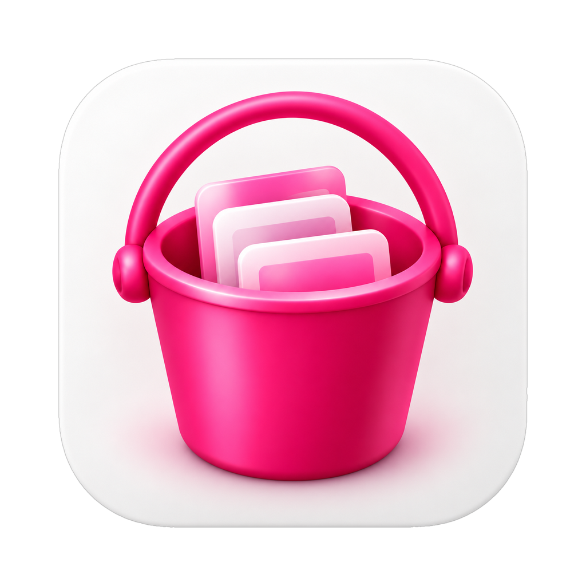
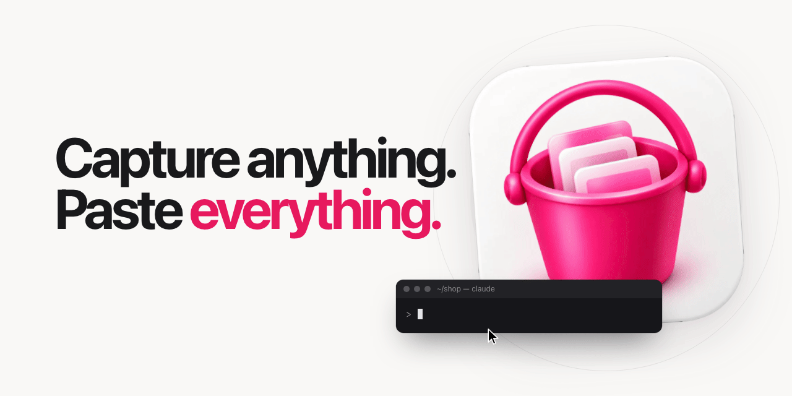

<p align="center">
  
</p>

<h1 align="center">Bucket</h1>

<p align="center"><strong>Just buckit.</strong><br>Capture anything. Paste everything.</p>

<p align="center">
  
</p>

Bucket is a menu bar app for macOS. You take screenshots the way you always do; they fall into a bucket. One
paste in your terminal drops the paths of all of them, and Claude Code attaches them as images.

## Who it is for

You work with a terminal agent and show it what you see: an error, a layout, a chart, a settings screen. Today that
means one screenshot, one drag or one path, and again. Bucket turns it into a loop with no friction: capture as many
as you need, paste once.

It is deliberately small. It is a clipboard with memory, not a screenshot editor and not a document manager.

## How it works

1. **Capture.** Press Cmd+Shift+4 and select an area. The selection is the native macOS one. The screenshot lands in the bucket.
2. **Repeat.** Take as many as you need. The menu bar icon and the panel show what is in the bucket.
3. **Paste.** Cmd+V in the terminal pastes the paths of every screenshot on one line, separated by spaces. Claude Code
   attaches them as images, with no files to save or drag in. When the paste happens, the bucket empties itself.

## Install

Requires macOS 14 (Sonoma) or later. The prebuilt zip is a universal binary (Apple Silicon and Intel). Building from
source needs Xcode or the Command Line Tools with Swift 5.9 or later (tested with Swift 6.2).

### Homebrew

```sh
brew install geheime/tap/bucket
```

The formula builds Bucket from source with the Swift toolchain (Xcode or Command Line Tools). It prints the
last step to link the app into `~/Applications` (the formula cannot write to `/Applications`). Every
`brew upgrade` builds a new ad-hoc signature, so macOS asks for Screen Recording again.

Because Homebrew builds the app on your Mac, it is not quarantined, so the "Open Anyway" step in "First launch"
should not be needed; that step is for the zip. (Not yet verified on a clean Mac.)

### Zip

1. Download `Bucket-<version>.zip` from the [latest release](https://github.com/geheime/bucket/releases/latest).
2. Unzip it and drag `Bucket.app` to `/Applications`. (`~/Applications` works too.) The zip also contains the
   `integrations` folder with the Claude Code skill.
3. Open it. See "First launch" below: Bucket is not notarized.

Verify the download before you open it: compare `shasum -a 256 Bucket-<version>.zip` with the SHA-256 printed in the
text of the release. The release also has `Bucket-<version>.zip.sha256`, and
`shasum -a 256 -c Bucket-<version>.zip.sha256` should say `OK`.

### Build from source

```sh
git clone https://github.com/geheime/bucket.git
cd bucket
scripts/package.sh 0.2.0     # builds, signs ad-hoc, writes dist/Bucket-0.2.0.zip (needs a clean git tree, or --allow-dirty)
```

or just `swift build -c release` and run `.build/release/Bucket`. No third-party dependencies.

## First launch

**Open an unnotarized app.** Bucket is signed ad-hoc and not notarized by Apple (see Limitations), so macOS blocks it
the first time. Try to open it once, then go to System Settings > Privacy & Security, scroll to the message about
Bucket and click **Open Anyway**. Or remove the quarantine flag from Terminal:

```sh
xattr -dr com.apple.quarantine /Applications/Bucket.app   # or ~/Applications/Bucket.app
```

Check the zip's SHA-256 against the release text first (see Privacy and security).

**Screen Recording.** Bucket needs the Screen Recording permission to take screenshots. The first time you capture
without it, macOS asks, and Bucket appears in System Settings > Privacy & Security > Screen Recording. Turn it on and
capture again. Until then the menu bar icon is struck through and a capture shows a pill that takes you to that
setting; when you come back, the icon clears by itself. If Bucket is not in the list, click + and choose Bucket.app.

**Free the Cmd+Shift+4 shortcut.** macOS already owns Cmd+Shift+4 for its own area screenshot. Bucket registers the
shortcut itself and does not change any system setting, so turn the native one off:

1. System Settings > Keyboard > Keyboard Shortcuts...
2. Screenshots
3. Untick "Save picture of selected area as a file" (the Cmd+Shift+4 entry).

If Bucket cannot take its shortcut because another app or macOS holds it, it says so: a pill when it starts, and the
menu shows "Cmd+Shift+4 is taken by another app". You can also pick another shortcut in the menu under **Capture
shortcut**: Cmd+Shift+4, Cmd+Shift+2 or Opt+Shift+2. Bucket only switches if the new one could be registered;
otherwise it keeps the current one. If Cmd+Shift+4 is your capture shortcut and the macOS one is still on, Bucket
tells you at launch and in the menu.

## Usage

- **Capture:** the capture shortcut, or **Capture** in the menu. Esc cancels the selection, as in macOS.
- **Paste:** Cmd+V in the terminal. The bucket empties when the paste actually happens.
- **Copy batch:** Opt+Shift+V (or **Copy batch** in the menu) copies the bucket now and empties it. If the bucket is
  empty, it re-copies the last batch instead (**Re-copy last batch** in the menu or panel), for example if you pasted
  into the wrong window.
- **Panel:** click the menu bar icon. Right-click or Control-click opens the menu instead.
- **Send last to Desktop:** in the menu. Copies the original of the newest screenshot in the bucket to your Desktop
  and takes it out of the bucket. The archive keeps its copy.
- **Remove from bucket / Clear bucket:** take screenshots out of the bucket without deleting them from the archive.
- **Paste format** (menu): bare paths (default and recommended), numbered with prompt, @paths, or one path per line.
- **Open archive:** opens `~/Bucket` in Finder.

### Pasting into apps and the web

Bucket lays out the clipboard for the app in front, and lays it out again when you switch apps:

- **Terminals** (iTerm2, Terminal, Ghostty, Warp, WezTerm, Alacritty, kitty, Hyper, and editors with an integrated
  terminal: VS Code, Cursor, Zed): the paths as text, in your paste format. This is the main use and it does not change.
- **Browsers:** one image per screenshot, so web chats get the images themselves.
- **Any other app**, such as the Claude and ChatGPT desktop apps: each screenshot as a file and as an image.

The bucket empties itself when it can tell that you pasted: in terminals and browsers. Desktop chat apps read the
clipboard as soon as they come to the front, before you paste, so Bucket cannot tell. There the bucket stays full
after the paste; clear it from the menu or panel, or paste the same batch in a terminal. If you copy something else,
Bucket never overwrites it.

The last batch you copied or pasted keeps following the app you switch to, so you can paste the same screenshots
in a terminal and then in a chat app, for as long as nothing else has replaced the clipboard.

Tested in iTerm2 with Claude Code, the Claude and ChatGPT desktop apps, claude.ai and chatgpt.com in Safari, and Notes.
The other terminals and browsers are listed by bundle id and expected to behave the same; they have not been tested.

## Let your agent find old screenshots

Every screenshot is read locally with Apple Vision (OCR) in the background. You can search by what is written in
them, or by the app that was in front when you captured:

```sh
/Applications/Bucket.app/Contents/MacOS/Bucket search "invoice total" --limit 5 --json
```

Words are combined with AND; case and accents are ignored. Results are newest first and include the file `path`,
the capture time, the front app and the matching text. Without `--json` you get one line per result.
`search` only reads: if `~/Bucket` does not exist yet, it prints nothing (`[]` with `--json`) and does not create it.
Unknown options exit with status 2 and the usage; `--help` prints the usage and `--version` the version.

For Claude Code there is a skill that teaches the agent to do this when you say "the screenshot where it said...".
Copy it into your skills folder:

```sh
mkdir -p ~/.claude/skills
cp -R integrations/claude-code/bucket-search ~/.claude/skills/
```

The skill uses `/Applications/Bucket.app/Contents/MacOS/Bucket` and tells the agent to use the `~/Applications` path
if that is where the app is; keep the app in one of those two places.

## Where everything is stored

```
~/Bucket/
  2026-10-24/            optimized PNG per screenshot (long edge up to 1568 px) + a .json sidecar with OCR text
  originals/2026-10-24/  the untouched capture; never pasted, kept as backup
  .state/                what is currently in the bucket
  batches.jsonl          one line per batch that was pasted or re-copied (batch id, screenshot ids, how)
```

Nothing is deleted automatically. The JSON sidecars are the index, so there is no database to repair. Removing a
screenshot from the bucket does not delete it from the archive.

## Privacy and security

Bucket runs entirely on your Mac. It makes no network connections, has no accounts, no analytics and no update
checker, and has no third-party dependencies. There is no MCP server and no local server of any kind: your agent gets
file paths through the clipboard and searches with a local command. OCR uses Apple's Vision framework on the device. This section says what
that means in practice, and what it does not cover.

**What is stored, and for how long.** For every screenshot, `~/Bucket` keeps the untouched PNG, an optimized PNG and
a JSON sidecar with the **full OCR text, in the clear**. That text can include passwords, tokens, emails or anything
else that was on your screen. Nothing expires: Bucket never deletes anything on its own. Treat `~/Bucket` as
sensitive data. Turning on FileVault is the single most useful thing you can do for it.

**Who can read it.** Bucket creates the archive for your user only (folders `drwx------`, files `-rw-------`), and it
tightens an existing `~/Bucket` to `0700` when it opens it. Screenshots you send to the Desktop keep that mode too.
Other apps running as you can still read it, as with any file in your home.

**Spotlight and Time Machine (recommendation, not verified).** Spotlight normally indexes the PNGs and JSON files, which
would make the OCR text searchable outside Bucket, and Time Machine would back it up. If you capture sensitive
things, consider excluding `~/Bucket` in System Settings > Spotlight > Search Privacy, and in Time Machine's options.
iCloud Drive does not sync `~/Bucket` unless you move it into a synced folder. We have not tested these behaviors
on every macOS version, so check them on your own Mac.

**How to delete.** Bucket has no delete or purge command yet. Remove screenshots by hand in Finder, or erase
everything with `rm -rf ~/Bucket` (this is permanent and also removes the originals).

**Permissions.** Bucket asks for Screen Recording only. It does not ask for Accessibility or Input Monitoring, does
not read your keystrokes (the shortcuts use the system hotkey API) and does not use the network. You can check the
last part yourself: `otool -L Bucket.app/Contents/MacOS/Bucket` lists system frameworks only, and the source is short.

**It does not change your system.** Bucket does not edit macOS settings. You turn off the native Cmd+Shift+4
yourself in System Settings > Keyboard > Keyboard Shortcuts > Screenshots.

**What gets pasted.** Bucket pastes file paths. Ordinary paths are pasted exactly as before; a path with spaces goes
in double quotes; a path with shell-special characters (`$`, quotes, `;`, `&`, parentheses, backticks...) gets a
backslash before each one, the way Finder does when you drag a file into a terminal, so it cannot run anything.
A path with a newline or other control character is not pasted at all. The backslash form is verified against zsh, not
against Claude Code. The archive is also treated as untrusted: a JSON file edited by hand cannot make Bucket copy the
contents of files outside `~/Bucket`.

**Distribution, signing and Gatekeeper.** The release zip is signed ad-hoc with the hardened runtime. That proves
nothing about who built it: there is no Apple Developer ID and no notarization. The real anchor of trust is building
from source, which has zero dependencies and no network code. If you use the zip:

- Compare its SHA-256 with the one printed **in the text of the GitHub release** (not only the `.sha256` file that
  travels with the zip, which protects nothing if someone replaced both):
  `shasum -a 256 -c Bucket-0.2.0.zip.sha256`.
- Open it with **Open Anyway** in System Settings > Privacy & Security (on macOS 15 and later Control-click is not enough).
- Use `xattr -dr com.apple.quarantine` only after the hash matches, and only on `Bucket.app` itself, never on
  `/Applications` as a whole.
- The zip hash cannot be reproduced by building it yourself (the signature and the build change the bytes); it is only
  good against the published hash.

**The Claude Code skill.** If you let an agent run Bucket, give it a narrow permission: only `search`, for example
`Bash(/Applications/Bucket.app/Contents/MacOS/Bucket search:*)`. The other subcommands are development tools and
refuse to run without `BUCKET_DEV=1`. And remember that the text of your screenshots reaches the agent: anything that
was on a web page you captured can contain instructions aimed at it. The skill tells the agent to treat that text as
untrusted data, but that is guidance, not a guarantee; do not give the agent permissions you would not give that page.

## FAQ

**Does it replace the macOS screenshot tool?**
It reuses it. The area selection is the native macOS one; Bucket decides where the file goes and what the paste looks like.

**Which agents does it work with?**
In the terminal it has only been tested with Claude Code. The terminal paste is plain text (file paths), so other
agents may accept it, but that is not tested and not promised. For desktop and web chat apps, see "Pasting into apps
and the web".

**Why did the bucket empty itself?**
That is the idea: once you paste, the batch is done. With the bucket empty, Opt+Shift+V puts the last batch back on
the clipboard, and the screenshots are always in the archive.

**Can I use my own shortcut?**
Not yet. There are three presets in the menu (see above).

**The first screenshot did nothing.**
Check the menu bar icon. If it is struck through, grant Screen Recording. If the menu says the shortcut is taken,
free the native macOS shortcut or pick another preset.

**I rebuilt the app and macOS asks for Screen Recording again.**
An ad-hoc signature changes with every build, and macOS ties the permission to the signature. Grant it again, or
sign your own builds with a stable local certificate (`scripts/make-signing-cert.sh`, used by `scripts/build.sh`).

## Limitations

- **Not notarized.** Bucket is not signed with an Apple Developer ID. The first launch needs "Open Anyway".
- **Tested with Claude Code** in the terminal, and with the apps and browser listed in "Pasting into apps and the web".
- **macOS 14 or later.** The release zip is universal (arm64 and x86_64). The Apple Silicon slice is what is used and
  tested day to day; the Intel slice has been checked to launch and run `search` under Rosetta, not on Intel hardware.
- Three shortcut presets, no custom recorder yet.
- English interface only.

## Development

```sh
swift build                 # debug build
swift run BucketChecks      # assert-based checks, no XCTest needed
swift build -c release
BUCKET_DEV=1 swift run Bucket render <state> <out.png> [--dark]   # renders the UI states to PNG (headless)
BUCKET_DEV=1 .build/debug/Bucket companion-check                  # the companion's own checks
```

The `Bucket` executable doubles as a headless CLI. Two subcommands are public: `search` and `ocr --backfill`.
The development ones (`ingest`, `render`, `render-motion`, `migrate`, `motion-smoke`, `companion-check`,
`companion-demo`) answer only when `BUCKET_DEV=1` is set; without it they are "unknown command". That way a
program allowed to run Bucket (an AI agent, for instance) can search and nothing else.
`--root <dir>` points any subcommand at an isolated archive instead of `~/Bucket`.
`BucketChecks` and `tools/make-media.sh` set `BUCKET_DEV=1` themselves.

`scripts/package.sh <version>` builds the release zip. See [docs/RELEASING.md](docs/RELEASING.md) for the release
process and [CHANGELOG.md](CHANGELOG.md) for what changed.

## License

[MIT](LICENSE) © 2026 Sebastián Vizzo
